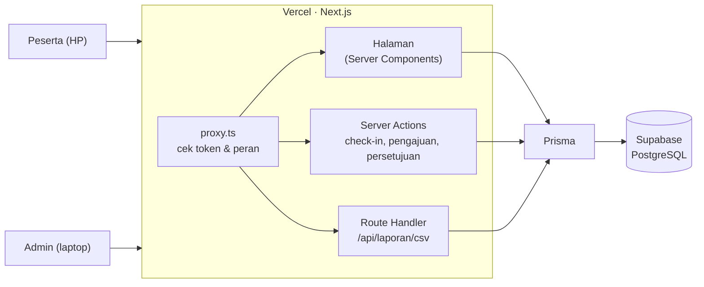
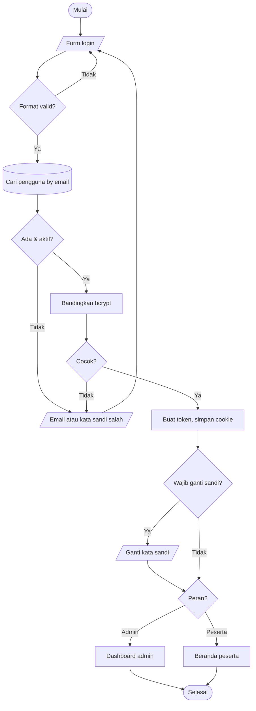
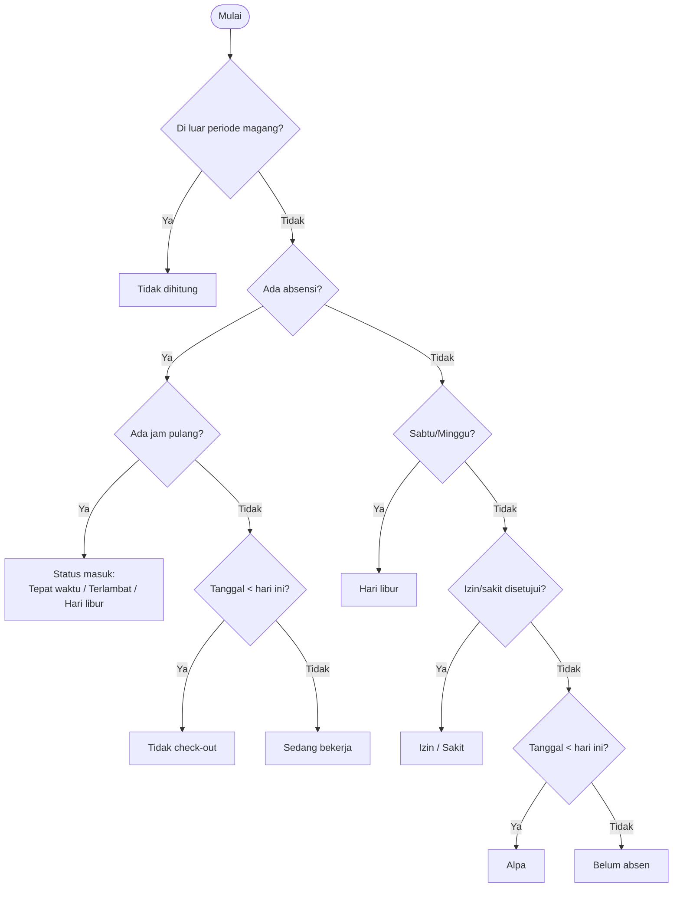
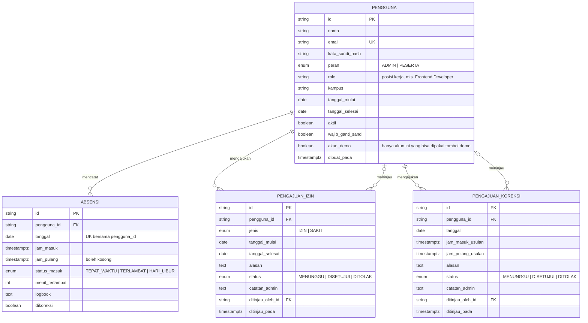

# Tahap 2 · Desain

Dokumen ini menjadi acuan sebelum menulis kode. Flowchart digambar ulang di draw.io; blok `mermaid` di bawah hanya gambaran bentuknya.

---

## 1. Arsitektur



- **Satu aplikasi, satu deploy.** Halaman, aksi, dan API berada di satu proyek Next.js.
- **Server Components** membaca data langsung lewat Prisma, jadi tidak ada API terpisah untuk menampilkan data.
- **Server Actions** dipakai untuk semua perubahan data (check-in, pengajuan, persetujuan). Setiap aksi memanggil `wajibPeran()` di baris pertama.
- **Route Handler** hanya untuk unduhan CSV, karena hasilnya file, bukan halaman.

---

## 2. Hak akses (RBAC)

| Halaman / aksi | Peserta | Admin |
| :--- | :---: | :---: |
| Beranda, check-in, check-out | ✓ | – |
| Riwayat & kalender milik sendiri | ✓ | – |
| Ajukan izin/sakit, ajukan koreksi | ✓ | – |
| Dashboard statistik | – | ✓ |
| Daftar, tambah, nonaktifkan peserta | – | ✓ |
| Detail peserta (kalender, riwayat, logbook) | – | ✓ |
| Laporan & unduh CSV | – | ✓ |
| Setujui / tolak izin dan koreksi | – | ✓ |
| Ganti kata sandi, mode gelap, keluar | ✓ | ✓ |

Pengecekan terjadi dua kali: `proxy.ts` mengarahkan URL `/peserta/*` dan `/admin/*` sesuai peran, lalu setiap Server Action mengecek ulang ke database. Menyembunyikan tombol hanya untuk kenyamanan, bukan keamanan.

---

## 3. Flowchart (digambar di draw.io)

### Simbol yang dipakai

| Simbol draw.io | Arti | Contoh |
| :--- | :--- | :--- |
| Terminator (oval) | Mulai / selesai | "Mulai", "Selesai" |
| Process (persegi panjang) | Langkah yang dikerjakan sistem atau pengguna | "Hitung tanggal hari ini (WIB)" |
| Decision (belah ketupat) | Percabangan Ya/Tidak | "Sudah check-in?" |
| Data / Input-Output (jajar genjang) | Input dari pengguna atau output ke layar | "Input email & kata sandi" |
| Database (silinder) | Baca/tulis ke database | "INSERT absensi" |
| Swimlane | Memisahkan Peserta, Sistem, Admin | FC-4 dan FC-5 |

Tips: tulis label **Ya** dan **Tidak** di setiap panah keluar dari belah ketupat, dan usahakan alur utama lurus ke bawah.

### FC-1 · Login dan pengarahan peran

1. **Mulai**
2. *I/O:* Tampilkan halaman login (form + tombol "Masuk sebagai Admin demo" / "Peserta demo")
3. *I/O:* Pengguna mengisi email & kata sandi (atau klik tombol demo)
4. *Decision:* Format valid? → **Tidak**: tampilkan pesan, kembali ke 3
5. *Database:* Cari pengguna berdasarkan email
6. *Decision:* Pengguna ada dan aktif? → **Tidak**: "Email atau kata sandi salah", kembali ke 3
7. *Process:* Bandingkan kata sandi dengan hash (bcrypt)
8. *Decision:* Cocok? → **Tidak**: pesan yang sama seperti langkah 6, kembali ke 3
9. *Process:* Buat token sesi (id, peran), simpan di cookie HttpOnly
10. *Decision:* Wajib ganti kata sandi? → **Ya**: halaman Ganti Kata Sandi, lalu lanjut ke 11
11. *Decision:* Peran? → **Admin**: ke Dashboard admin · **Peserta**: ke Beranda peserta
12. **Selesai**

Catatan: pesan di langkah 6 dan 8 sengaja sama, supaya orang lain tidak bisa menebak email mana yang terdaftar.



### FC-2 · Check-in

1. **Mulai** → peserta membuka Beranda
2. *Process:* Ambil waktu server, hitung tanggal hari ini dalam WIB
3. *Database:* Ambil absensi peserta untuk tanggal itu
4. *Decision:* Sudah check-in? → **Ya**: tampilkan jam masuk dan tombol Check-out, **Selesai**
5. *I/O:* Peserta menekan **Check-in** (tombol langsung nonaktif agar tidak terkirim dua kali)
6. *Process:* Server mengecek peran (harus Peserta)
7. *Decision:* Hari kerja (Senin–Jumat)? → **Tidak**: status = Hari libur, lompat ke 10
8. *Decision:* Jam sekarang ≤ 09.15? → **Ya**: status = Tepat waktu · **Tidak**: status = Terlambat, hitung menit terlambat
9. *(gabung)*
10. *Database:* INSERT absensi (peserta, tanggal, jam masuk, status)
11. *Decision:* Tersimpan? → **Tidak** (sudah ada absensi di tanggal itu): "Kamu sudah check-in hari ini"
12. *I/O:* Notifikasi "Check-in berhasil pukul 08.52"
13. **Selesai**

Poin interview: aturan "satu kali per hari" dijaga oleh **constraint unik di database** (langkah 11), bukan oleh tombol. Dua klik yang hampir bersamaan pun hanya menghasilkan satu baris.

### FC-3 · Check-out dan logbook

1. **Mulai** → peserta menekan **Check-out**
2. *I/O:* Dialog meminta logbook: "Apa yang kamu kerjakan hari ini?" (minimal 10 karakter)
3. *Decision:* Logbook valid? → **Tidak**: tampilkan pesan, kembali ke 2
4. *Process:* Server mengecek peran
5. *Database:* UPDATE absensi hari ini SET jam pulang, logbook **WHERE jam pulang masih kosong**
6. *Decision:* Ada 1 baris yang berubah? → **Tidak**: "Kamu belum check-in atau sudah check-out"
7. *Process:* Hitung durasi kerja
8. *I/O:* "Check-out berhasil. Kamu bekerja 8 jam 12 menit hari ini."
9. **Selesai**

Langkah 5 memakai pola yang sama dengan sistem kuota di Kemlu: syarat dan perubahan dalam satu perintah, jadi tidak ada celah di antara "cek" dan "ubah".

### FC-4 · Izin / sakit (pakai swimlane Peserta · Sistem · Admin)

| Lajur | Langkah |
| :--- | :--- |
| Peserta | 1. Buka menu Pengajuan → 2. Pilih jenis (Izin/Sakit), tanggal mulai–selesai, tulis alasan → 3. Kirim |
| Sistem | 4. *Decision:* Valid? (selesai ≥ mulai, maksimal 14 hari, alasan ≥ 10 karakter, tidak bentrok dengan pengajuan lain yang menunggu/disetujui) → **Tidak**: pesan ke peserta, kembali ke 2 → 5. *Database:* simpan status **Menunggu** |
| Admin | 6. Buka Persetujuan → 7. *Decision:* Setujui? → **Ya**: status **Disetujui** · **Tidak**: 8. isi alasan penolakan (wajib) → status **Ditolak** |
| Sistem | 9. *Database:* catat peninjau dan waktunya → 10. Peserta melihat status terbaru; hari yang disetujui dihitung Izin/Sakit di laporan → **Selesai** |

### FC-5 · Koreksi absensi (pakai swimlane)

| Lajur | Langkah |
| :--- | :--- |
| Peserta | 1. Buka Riwayat → 2. Pilih hari berstatus **Tidak check-out** atau **Alpa** → 3. Tekan "Ajukan koreksi" → 4. Isi jam masuk dan/atau jam pulang yang benar + alasan → 5. Kirim |
| Sistem | 6. *Decision:* Valid? (tanggal sudah lewat, maksimal 7 hari ke belakang, jam pulang > jam masuk, belum ada koreksi yang menunggu untuk tanggal itu) → **Tidak**: pesan, kembali ke 4 → 7. *Database:* simpan status **Menunggu** |
| Admin | 8. Buka Persetujuan, tab Koreksi → 9. *Decision:* Setujui? → **Tidak**: isi alasan → **Ditolak** |
| Sistem | 10. Jika disetujui, dalam **satu transaksi**: ubah atau buat absensi tanggal itu dengan jam usulan, hitung ulang statusnya, tandai **Dikoreksi**, ubah status pengajuan jadi **Disetujui** → **Selesai** |

Kenapa satu transaksi: kalau absensi berhasil diubah tapi status pengajuan gagal tersimpan (atau sebaliknya), datanya tidak konsisten. Transaksi membuat keduanya berhasil bersama atau batal bersama.

### FC-6 · Penentuan status harian

Ini fungsi `statusHarian(peserta, tanggal)` yang dipakai di kalender, riwayat, dashboard, dan laporan.



Sabtu/Minggu dicek **sebelum** izin. Kalau peserta izin Jumat sampai Senin, yang terhitung izin hanya 2 hari kerja, bukan 4.

### FC-7 · Laporan dan unduh CSV

1. **Mulai** → admin membuka Laporan
2. *I/O:* Pilih periode (bawaan: bulan ini) dan kata kunci nama
3. *Database:* Ambil peserta, absensi, dan izin yang disetujui dalam periode
4. *Process:* Untuk setiap peserta dan setiap tanggal, jalankan FC-6
5. *Process:* Jumlahkan: hari kerja, hadir, tepat waktu, terlambat, izin, sakit, alpa, tidak check-out, rata-rata jam masuk, total jam kerja, persentase kehadiran
6. *I/O:* Tampilkan tabel rekap
7. *Decision:* Unduh CSV? → **Ya**: buat file CSV (pemisah titik koma, UTF-8 dengan BOM agar langsung rapi di Excel berbahasa Indonesia) → unduh
8. **Selesai**

---

## 4. ERD



### Aturan di tingkat database

| Tabel | Constraint / index | Alasan |
| :--- | :--- | :--- |
| `pengguna` | `email` unik | Satu email satu akun |
| `absensi` | **unik (`pengguna_id`, `tanggal`)** | Satu absensi per peserta per hari, tidak bisa dilanggar walau ada klik ganda |
| `absensi` | index `tanggal` | Dashboard dan laporan selalu memfilter per tanggal |
| `pengajuan_izin` | index (`pengguna_id`, `status`) | Cek bentrok dan daftar "menunggu" |
| `pengajuan_koreksi` | **unik sebagian** (`pengguna_id`, `tanggal`) **WHERE status = 'MENUNGGU'** | Hanya satu koreksi menunggu per tanggal; setelah ditolak, peserta boleh mengajukan lagi |

### Keputusan desain yang perlu bisa kamu jelaskan

- **`tanggal` disimpan terpisah dari `jam_masuk`.** Jam disimpan lengkap dengan zona waktu (UTC di database), sedangkan `tanggal` adalah tanggal kalender WIB. Tanpa kolom ini, absen pukul 06.30 WIB (23.30 UTC hari sebelumnya) bisa tercatat di tanggal yang salah.
- **Alpa tidak disimpan.** Alpa adalah "tidak ada data di hari kerja". Menyimpannya berarti butuh job harian; menghitungnya saat laporan dibuat lebih sederhana dan selalu benar.
- **Koreksi tidak punya foreign key ke absensi.** Untuk kasus lupa check-in, baris absensinya belum ada. Koreksi dicocokkan lewat (`pengguna_id`, `tanggal`), lalu saat disetujui absensinya dibuat atau diubah.
- **Kolom `dikoreksi`** menjaga jejak: admin tetap bisa melihat absensi mana yang jamnya hasil koreksi.

---

## 5. Desain tampilan

Nama kerja aplikasi: **Hadir** (nama netral, bisa diganti sebelum rilis).

### Arah visual: Buku Rapor

Kehadiran dibaca seperti rapor sekolah. Rapor Indonesia sudah punya blok **"Ketidakhadiran: Sakit · Izin · Tanpa keterangan"**, persis data yang dikelola aplikasi ini. Dunia rapor dipakai untuk empat hal saja: warna, tipografi, kepadatan tabel, dan satu ciri khas. Navigasi, tombol, form, dan tabel tetap komponen web standar yang langsung dikenali.

Tiga aturan yang membuat arah ini konsisten:

| Aturan | Artinya di layar |
| :--- | :--- |
| **Cetakan sistem berwarna hitam** | Semua yang dicatat sistem (tanggal, jam masuk, status, angka) memakai tinta cetak. |
| **Tulisan peserta berwarna biru tinta pulpen** | Teks yang ditulis peserta sendiri (logbook, alasan izin, alasan koreksi) selalu biru. Admin langsung tahu mana data sistem dan mana keterangan peserta. |
| **Keputusan admin diberi cap** | Pengajuan yang disetujui atau ditolak, dan absensi hasil koreksi, membawa cap stempel bulat: `DISETUJUI · 05.11 · AD`. Ini wujud nyata prinsip "setiap perubahan punya jejak persetujuan". |

**Ciri khas (signature move): cap stempel.** Muncul di kartu persetujuan, di daftar pengajuan peserta, dan sebagai cap kecil `DIKOREKSI` di baris riwayat. Saat admin menekan Setujui, cap "mendarat": membesar sedikit lalu menetap dengan kemiringan −9°, 180 ms. Hanya ini satu-satunya animasi yang disengaja; selain itu, gerak hanya untuk umpan balik (hover, fokus, memuat). Pengguna dengan pengaturan *reduce motion* melihat cap langsung tanpa animasi.

Hal yang diambil dari arah lain yang tidak dipilih:

- Durasi kerja selalu rata kanan dalam angka tabular, dan dibaca terhadap satu "sisi" 8 jam (misalnya bar tipis 7 j 42 m dari 8 j).
- Kalender dan grafik semua peserta memakai skala yang sama, jadi dua peserta bisa dibandingkan berdampingan dengan jujur.
- Tidak ada label yang ditulis dua kali; setiap layar punya satu angka utama, sisanya tenang.
- Keterlambatan memakai satu skala warna: makin lama terlambat, makin pekat warnanya, bukan warna baru.
- Setiap peserta punya "perabot" tetap yang selalu di posisi sama: inisial, kampus, tanggal mulai, satu baris logbook terakhir.

### Yang sengaja dihindari

Template admin (sidebar abu gelap + kartu angka bergradien), gradien, efek kaca, bayangan tebal, emoji di antarmuka, dasar krem, ikon dekoratif tanpa fungsi, dan gaya gamifikasi (lencana, poin, konfeti).

### Token desain

**Tipografi.** Satu keluarga: **Public Sans**. Huruf ini dirancang untuk formulir dan layanan pemerintah (U.S. Web Design System), dekat dengan karakter rapor sebagai dokumen resmi, sangat terbaca di ukuran kecil, dan punya angka tabular. Skala tetap (rem, rasio ±1,2): 12 · 14 · 16 · 20 · 24 · 30. Label kolom tabel: 12 px, huruf kapital, jarak huruf sedikit dilebarkan, seperti kepala kolom rapor. Semua jam, tanggal, dan angka memakai `tabular-nums`.

**Warna (mode terang).**

| Token | Nilai | Peran |
| :--- | :--- | :--- |
| `sampul` | `#1E4636` | Rel menu admin, header peserta, tombol utama |
| `sampul-aktif` | `#285A46` | Menu aktif di rel |
| `kertas` | `#F5F7F4` | Latar halaman (putih kehijauan dingin, bukan krem) |
| `lembar` | `#FFFFFF` | Kartu dan tabel |
| `garis` | `#D5DBD6` | Garis tabel dan tepi kartu |
| `tinta-cetak` | `#1A1D1B` | Teks utama |
| `tinta-pudar` | `#5E6661` | Teks sekunder, kepala kolom |
| `tinta-biru` | `#2747A0` | Teks yang ditulis peserta |
| `cap` | `#6A3FA0` | Cap DISETUJUI dan DIKOREKSI |
| `cap-tolak` | `#B42318` | Cap DITOLAK |

**Warna status.** Selalu bersama ikon dan teks, tidak pernah warna saja.

| Status | Warna | Ikon |
| :--- | :--- | :--- |
| Tepat waktu | `#1F7A4D` hijau | centang |
| Terlambat | `#B7791F` kuning tua, makin pekat makin lama | jam |
| Izin | `#0369A1` biru langit | dokumen |
| Sakit | `#0F766E` hijau toska | plus medis |
| Alpa | `#B42318` merah | silang |
| Tidak check-out | `#C2410C` oranye | pintu keluar |
| Hari libur / di luar periode | `#8A938D` abu | garis |

**Mode gelap.** Sampul `#10261D`, kertas `#0F1412`, lembar `#161C19`, garis `#26302B`, tinta cetak `#E7ECE9`, tinta biru `#8FA8F0`, cap `#B79BE3`; warna status dinaikkan terangnya agar kontras tetap AA. Grafik ikut berganti karena warnanya diambil dari variabel CSS.

**Bentuk.** Sudut 10 px untuk kartu, 8 px untuk tombol dan input. Garis 1 px. Tanpa bayangan di halaman (rapor itu kertas datar); bayangan tipis hanya untuk dialog dan menu yang melayang. Ikon garis 16 px, ketebalan 1,75.

### Navigasi

- **Peserta (HP):** header hijau sampul berisi nama aplikasi, lalu di kanan: tombol tema, nama dan inisial peserta, tombol keluar. Tab bawah dengan 4 menu: Beranda · Riwayat · Pengajuan · Profil.
- **Admin (laptop):** rel kiri hijau sampul: Dashboard · Peserta · Laporan · Persetujuan (angka antrean) · Profil. Di bawah: nama akun, dengan tombol tema dan keluar di kanannya. Di HP, rel menjadi menu geser dengan isi yang sama.
- Tombol tema dan keluar sengaja tidak di halaman Profil: keduanya bisa dijangkau dari halaman mana pun tanpa pindah halaman.

### Rancangan layar

**Login.** Kartu putih di atas kertas: nama aplikasi, satu kalimat ("Catat kehadiran magangmu"), form email dan kata sandi, tombol Masuk. Di bawah garis pemisah: dua tombol akun demo (Admin dan Peserta) dengan keterangan kecil "Untuk mencoba aplikasi tanpa mendaftar".

**Beranda peserta (HP)**
```
┌─────────────────────────────┐
│ Hadir           ☾  RM  ⇥   │  ← header: tema, inisial, keluar
├─────────────────────────────┤
│ Kamis, 5 November 2026      │
│ ┌─────────────────────────┐ │
│ │ 08.47.12                │ │  ← jam berjalan, sumber waktu server
│ │ Jam masuk 09.00 WIB     │ │
│ │ [     Check-in      ]   │ │  ← tombol besar hijau sampul
│ └─────────────────────────┘ │
│ Ketidakhadiran November     │
│ ┌──────────────┬──────────┐ │
│ │ Sakit        │   0 hari │ │  ← blok rapor, tabel bergaris
│ │ Izin         │   1 hari │ │
│ │ Tanpa ket.   │   0 hari │ │
│ └──────────────┴──────────┘ │
│ Kalender kecil November     │
├─────────────────────────────┤
│ Beranda Riwayat Pengajuan Profil │
└─────────────────────────────┘
```
Setelah check-in, kartu menjadi lembar hari ini: **Masuk 08.47 · Tepat waktu**, durasi berjalan rata kanan, tombol berubah menjadi **Check-out**. Check-out membuka lembar bawah berisi kolom logbook; teks yang diketik tampil biru.

**Riwayat (peserta).** Ringkasan bulan (kehadiran dan total jam kerja), lalu tombol ganti tampilan Daftar / Kalender. Daftar: tabel bergaris dengan tanggal, masuk, pulang, durasi (rata kanan), status; logbook di bawah baris dalam tinta biru. Baris hasil koreksi membawa cap kecil DIKOREKSI. Hari Tidak check-out atau Alpa punya tautan "Ajukan koreksi".

**Pengajuan (peserta).** Tab Izin/Sakit dan Koreksi. Form di atas; daftar pengajuan di bawah. Pengajuan yang sudah diputuskan membawa cap DISETUJUI atau DITOLAK beserta catatan admin.

**Dashboard admin**
```
┌────────────┬───────────────────────────────────────────────────┐
│ Hadir      │ Kamis, 5 November 2026 · 10.42 WIB                │
│ ▌Dashboard │ Dashboard                       [Periode ▾]       │
│  Peserta   │ ┌ Hadir 4/6 ┬ Terlambat 1 ┬ Sakit/Izin 1 ┬ Belum absen 1 ┐ │  ← satu tabel bergaris
│  Laporan   │ ┌ Kehadiran 10 hari kerja ─────────┐ ┌ Ketidakhadiran ┐ │
│  Persetujuan 2│ │ batang bertumpuk, skala tetap   │ │ blok rapor     │ │
│  Profil    │ └──────────────────────────────────┘ └───────────────┘ │
│            │ ┌ Peserta hari ini ────────────────┐ ┌ Persetujuan ──┐ │
│ Admin Demo ☾⇥│ nama · masuk · status · logbook │ │ kartu + cap   │ │
└────────────┴───────────────────────────────────────────────────┘
```
Angka hari ini sengaja satu tabel bergaris, bukan empat kartu terpisah. Di bawahnya hanya dua baris: grafik kehadiran 10 hari kerja (batang bertumpuk per status, skala 0–6 peserta) bersama blok Ketidakhadiran bulan berjalan, lalu tabel peserta hari ini dengan logbook terakhir (biru) bersama antrean persetujuan. Grafik rata-rata jam masuk dan daftar "perlu perhatian" sempat dibuat, lalu dihapus pada revisi karena membuat dashboard terlalu penuh; informasinya tetap ada di Laporan.

**Peserta (admin).** Tabel: inisial + nama, kampus, tanggal mulai, status hari ini, jam masuk, kehadiran bulan ini (%), aktif/nonaktif. "Tambah peserta" membuka dialog (nama, email, kampus, role, tanggal mulai); setelah disimpan, kata sandi sementara ditampilkan sekali dengan tombol salin.

**Detail peserta (admin).** Perabot tetap di atas (inisial, nama, kampus, tanggal mulai), blok Ketidakhadiran, kalender bulan berjalan dengan skala yang sama seperti peserta lain, lalu tabel riwayat dengan logbook.

**Laporan (admin).** Filter periode (Minggu ini, Bulan ini, pilih tanggal) dan pencarian nama. Tabel rekap bergaris: hari kerja, hadir, tepat waktu, terlambat, izin, sakit, alpa, tidak check-out, rata-rata jam masuk, total jam kerja, persentase kehadiran. Tombol **Unduh CSV**.

**Persetujuan (admin).** Tab Izin/Sakit dan Koreksi. Setiap kartu: nama, jenis, tanggal, alasan peserta (biru), tombol Tolak / Setujui. Tolak membuka kolom alasan. Setelah diputuskan, cap mendarat di kartu dan kartu pindah ke tab Riwayat.

### Keadaan khusus

| Keadaan | Tampilan |
| :--- | :--- |
| Memuat | Kerangka (skeleton) berbentuk sama dengan isinya, garis tabel tetap terlihat |
| Kosong | Kalimat yang mengajari langkah berikutnya. Contoh: "Belum ada pengajuan. Kalau berhalangan hadir, ajukan izin di sini." |
| Gagal | Pesan jelas dalam bahasa sehari-hari + tombol Coba lagi, tanpa kode error |
| Memproses | Tombol nonaktif dengan teks "Menyimpan…" |
| Berhasil | Notifikasi singkat di bawah layar: "Check-in berhasil pukul 08.47" |
| Offline (PWA) | "Kamu sedang offline. Absensi butuh koneksi internet agar jamnya tercatat dari server." |

### PWA

- `manifest.webmanifest`: nama "Hadir · Absensi Magang", tampilan *standalone*, warna tema `#1E4636`, ikon 192 dan 512 px (huruf H di atas hijau sampul).
- Service worker kecil: menyimpan aset tampilan dan halaman offline. **Check-in tidak bisa dilakukan saat offline**, karena jam absen harus dari server.

---

## 6. Desain aksi server

| Aksi | Peran | Input | Aturan utama |
| :--- | :--- | :--- | :--- |
| `masuk` | – | email, kata sandi | Pesan error sama untuk email salah dan sandi salah |
| `masukDemo` | – | peran | Hanya untuk akun demo yang sudah disiapkan |
| `keluar` | semua | – | Hapus cookie sesi |
| `gantiKataSandi` | semua | sandi lama, sandi baru | Minimal 8 karakter, berbeda dari yang lama |
| `checkIn` | Peserta | – | Waktu dari server, unik per hari |
| `checkOut` | Peserta | logbook | UPDATE bersyarat jam pulang masih kosong |
| `ajukanIzin` | Peserta | jenis, rentang tanggal, alasan | Tidak bentrok, maksimal 14 hari |
| `batalkanIzin` | Peserta | id | Hanya milik sendiri dan masih Menunggu |
| `ajukanKoreksi` | Peserta | tanggal, jam masuk/pulang, alasan | Tanggal lewat, ≤ 7 hari, satu yang menunggu per tanggal |
| `tambahPeserta` | Admin | nama, email, kampus, tanggal mulai | Buat kata sandi sementara, wajib diganti |
| `ubahStatusPeserta` | Admin | id, aktif | Admin tidak bisa menonaktifkan dirinya sendiri |
| `tinjauIzin` | Admin | id, keputusan, catatan | Penolakan wajib beralasan |
| `tinjauKoreksi` | Admin | id, keputusan, catatan | Disetujui → transaksi ubah absensi + status |
| `GET /api/laporan/csv` | Admin | dari, sampai | File CSV titik koma + BOM |

Semua input divalidasi dengan **Zod** di server, walaupun form di browser juga memvalidasi. Validasi di browser untuk kenyamanan, validasi di server untuk keamanan.

---

## 7. Struktur folder

```
absensi-magang/
├─ prisma/
│  ├─ schema.prisma        model & relasi (sesuai ERD)
│  ├─ migrations/          riwayat perubahan skema
│  └─ seed.ts              akun demo + data contoh 2 minggu
├─ src/
│  ├─ app/
│  │  ├─ login/            halaman login
│  │  ├─ ganti-kata-sandi/
│  │  ├─ peserta/          beranda, riwayat, pengajuan, profil
│  │  ├─ admin/            dashboard, peserta, laporan, persetujuan, profil
│  │  ├─ api/laporan/csv/  unduhan CSV
│  │  ├─ offline/          halaman saat tidak ada koneksi
│  │  ├─ ikon/[ukuran]/    ikon PWA (PNG)
│  │  └─ manifest.ts       PWA
│  ├─ actions/             server actions per fitur
│  ├─ components/          komponen tampilan (ui/ dari shadcn)
│  ├─ lib/
│  │  ├─ auth.ts, sesi.ts  sesi JWT, wajibPeran()
│  │  ├─ waktu.ts          tanggal WIB, hari kerja, format Indonesia
│  │  ├─ status.ts         statusHarian() (FC-6)
│  │  ├─ rekap.ts          rekap (FC-7)
│  │  ├─ periode.ts        pilihan periode laporan
│  │  ├─ data.ts           query untuk setiap halaman
│  │  └─ db.ts             koneksi Prisma
│  └─ proxy.ts             cek token & peran di setiap request
├─ public/sw.js            service worker
├─ docs/                   dokumen tahap 1–4
└─ README.md
```
